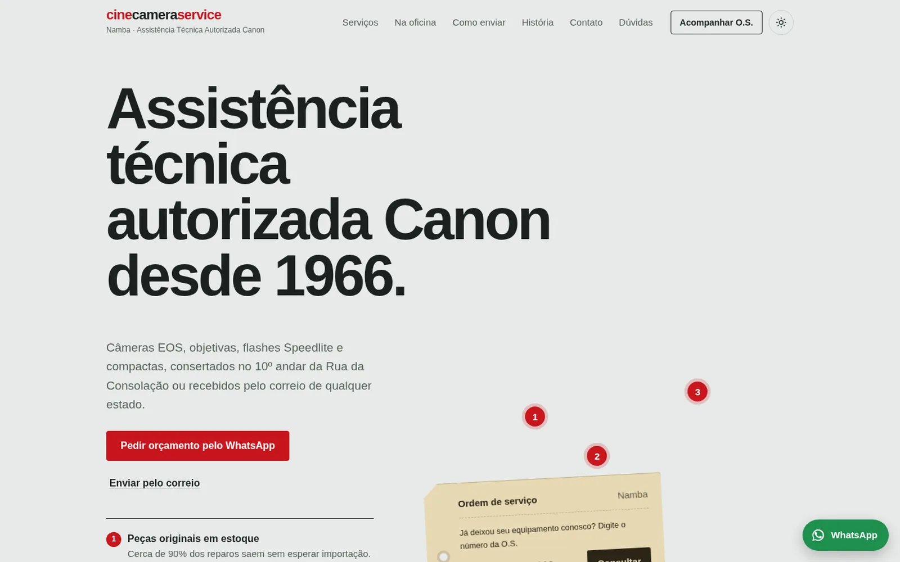

<p align="center">
  
</p>

<p align="center">
  
  
  
  
</p>

<p align="center">
  Demo de site e sistema para uma assistência técnica Canon de São Paulo, com consulta de ordem de serviço, carta de envio, assistente virtual e painel da equipe.
</p>

<p align="center">
  <a href="https://lorenzo-or7.github.io/namba-demo/"><b>🔗 Acessar o site</b></a>
</p>

---

## 🖥️ Preview

<p align="center">
  <a href="https://lorenzo-or7.github.io/namba-demo/"></a>
</p>

---

## 📌 Sobre o projeto

A Namba é uma oficina de família, autorizada Canon desde 1966. Além do site institucional, a proposta inclui as ferramentas do dia a dia: o cliente acompanha a ordem de serviço e gera a carta de envio, e a equipe gerencia clientes e O.S. num painel próprio.

Visual limpo com **vermelho** de destaque, serifa editorial (Newsreader) com Schibsted Grotesk e ilustrações em traço vetorizadas que mudam de cor no tema escuro.

---

## ✨ Funcionalidades

- 🏢 Site institucional: serviços, oficina, história e visita
- 🔧 Passo a passo do equipamento na oficina
- 🔎 Consulta pública de ordem de serviço
- ✉️ Carta de envio para imprimir, com máscaras e CEP automático
- 🤖 Assistente virtual (Carmen) para tirar dúvidas
- 🔐 Painel da equipe com login
- 🗂️ Cadastro e edição de O.S. e clientes
- 🌗 Tema claro e escuro
- 📱 Layout responsivo

---

## 🛠️ Tecnologias

- **HTML5** para a estrutura
- **CSS3** para identidade visual, responsividade e animações
- **JavaScript** puro para as interações
- **GitHub Pages** para hospedagem

Protótipo estático de uma versão em PHP: cada página `.html` equivale a uma página `.php` do sistema real.

---

## ⚙️ Como rodar

Não precisa instalar nada: baixe o repositório e abra o arquivo `index.html` no navegador.

```bash
git clone https://github.com/lorenzo-or7/namba-demo.git
```

> Este é um projeto demonstrativo: a consulta de O.S. e o painel usam dados fictícios salvos no navegador. Login de demonstração: `demo` / `namba2026`.

---

## 👨‍💻 Autor

<p>
  Feito por <b>Lorenzo Orsetti</b><br/>
  <a href="https://lorenzo-or7.github.io">
    
  </a>
  <a href="https://www.linkedin.com/in/lorenzo-orsetti-031906349/">
    
  </a>
  <a href="https://github.com/lorenzo-or7">
    
  </a>
</p>

<p align="center">
  
</p>
